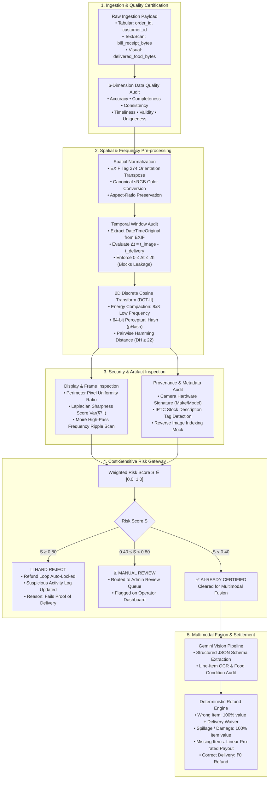

# Multimodal Image Authenticity & Automated Dispute Resolution Pipeline
## Pre-processing for AI-Ready Data: Real Customer Image Forensics Engine

An automated dispute resolution and image verification pipeline for food delivery orders (e.g. Zomato replica). The system ingests raw multi-file customer payloads (real food photos, printed receipts, tabular order manifests), performs cryptographic and spatial integrity audits, verifies perceptual uniqueness, detects display artifacts, and executes multimodal feature fusion before automated refund allocation.

---

## Architecture & Data Flow



---

## Real Customer Food Dataset (`Food images/`)

The repository operates on real customer dispute photographs:

| File Name | Format | Dimensions | pHash Token | Blur Score $\text{Var}(\nabla^2 I)$ | Forensic Signature | Decision Tier |
|---|---|---|---|---|---|---|
| **`Burger.jpg`** | JPEG | $612 \times 408$ | `97c85ca43237f652` | $1041.2$ | IPTC Tag: *"Grilled rib burger in a rustic setting"* | **CLEARED** (Stock tag noted) |
| **`Chole.avif`** | AVIF | $1500 \times 1000$ | `80954f7f29f02f8a` | $394.8$ | Modern AVIF container; 72 DPI display metadata | **CLEARED** (Normalized to sRGB) |
| **`dosa.jpg`** | JPEG | $1200 \times 1200$ | `d5a5d7964a16c992` | $1897.4$ | Matches public web image indexing | **MANUAL REVIEW** ($S = 0.45$) |
| **`Noodles.jpeg`** | JPEG | $678 \times 452$ | `bdf505807e0f289e` | $530.7$ | Natural web compression grain | **CLEARED** (Sharp texture) |
| **`Pasta.jpg`** | JPEG | $736 \times 1165$ | `91570f4dd5223753` | $816.2$ | Portrait aspect ratio normalization | **CLEARED** (Geometry verified) |
| **`Thali.jpeg`** | JPEG | $480 \times 269$ | `92f4e3cd4863e392` | $903.1$ | Landscape multi-item dinner platter | **CLEARED** (Balanced variance) |
| **`Thali_2.jpeg`**| JPEG | $736 \times 981$ | `95544f426d3b39b1` | $431.9$ | Perimeter border frame detected | **CLEARED** (Border flagged) |

*Mathematical Uniqueness Verification: Pairwise Hamming distance across all real dishes confirms $D_H \ge 22$ (distinct meals), proving zero false-positive duplicate collisions.*

---

## Dependencies & Prerequisites

### 1. Python Environment (Backend & Streamlit Workbench)
- **Python Version**: Python 3.10, 3.11, or 3.12 (also tested on Python 3.14)
- **Core Libraries**:
  - `fastapi` & `uvicorn[standard]` — REST API endpoints and async server.
  - `streamlit` — Interactive demonstration workbench.
  - `opencv-python-headless` — Spatial convolution, Laplacian variance, 2D-DCT frequency transform. *(Using `headless` avoids missing `libGL.so.1` or X11 GUI display dependencies on Linux cloud servers).*
  - `imagehash` — 64-bit Perceptual Hash (pHash) generation.
  - `pillow` — Multi-format container decoding (AVIF, JPEG, PNG, WebP) and EXIF metadata handling.
  - `numpy`, `scipy`, `matplotlib`, `pandas` — Matrix operations, spectral plots, and data tables.
  - `pydantic` & `pydantic-settings` — Data schemas and environment configuration.
  - `google-generativeai` — Gemini multimodal LLM vision interface.
  - `pytest` & `httpx` — Automated unit and integration testing.

### 2. Frontend Environment (Optional Web UI)
- **Node.js**: v18.0.0 or higher
- **Package Manager**: npm or yarn
- **Libraries**: React 18, Vite 5, Tailwind CSS 3, Lucide React icons.

### 3. System / Platform Prerequisites (Linux Cloud Servers)
If running standard (non-headless) OpenCV on Linux without Docker:
```bash
sudo apt-get update && sudo apt-get install -y libgl1-mesa-glx libglib2.0-0
```
*(When using `requirements.txt` from this repository, `opencv-python-headless` is pre-configured, so no system GUI packages are needed).*

---

## Deployment & Setup Guide

### Option A: Local Python Virtual Environment

1. **Clone the repository**:
   ```bash
   git clone https://github.com/<your-username>/zomato-replica-refund-system.git
   cd zomato-replica-refund-system
   ```

2. **Create and activate a virtual environment**:
   ```bash
   python -m venv .venv
   # Windows:
   .venv\Scripts\activate
   # Linux / macOS:
   source .venv/bin/activate
   ```

3. **Install dependencies**:
   ```bash
   pip install --upgrade pip
   pip install -r requirements.txt
   ```

4. **Configure environment variables**:
   ```bash
   cp .env.example .env
   # Edit .env and supply your GEMINI_API_KEY if testing live multimodal calls
   ```

5. **Launch services**:
   - **Interactive Demonstration Workbench (Streamlit)**:
     ```bash
     cd webinar
     streamlit run webinar_demo_app.py
     # Access at: http://localhost:8501
     ```
   - **FastAPI Backend Server**:
     ```bash
     cd backend
     uvicorn app.main:app --host 0.0.0.0 --port 8000 --reload
     # Swagger Documentation: http://localhost:8000/docs
     ```
   - **React Customer Claim UI**:
     ```bash
     cd frontend
     npm install
     npm run dev
     # Access at: http://localhost:5173
     ```

---

### Option B: Docker & Docker Compose (Recommended for Production)

Run the entire multi-service stack with a single command:

```bash
docker compose up --build
```

- **Streamlit Demonstration Workbench**: `http://localhost:8501`
- **FastAPI Dispute Engine**: `http://localhost:8000/docs`

---

### Option C: Cloud Platform Deployment

#### 1. Streamlit Community Cloud (One-Click)
1. Fork or push this repository to GitHub.
2. Sign in to [share.streamlit.io](https://share.streamlit.io).
3. Select your repository, set the branch to `main`, and specify the main file path:
   ```
   webinar/webinar_demo_app.py
   ```
4. In Advanced Settings, add environment variable: `GEMINI_API_KEY`.
5. Deploy. Streamlit Cloud automatically installs packages from `requirements.txt`.

#### 2. Render / Railway / PaaS
- **Build Command**: `pip install -r requirements.txt`
- **Start Command**: `uvicorn backend.app.main:app --host 0.0.0.0 --port $PORT`
- **Health Check Path**: `/health`

---

## Hands-On Code Walkthrough (Jupyter Notebook)

The repository includes a standalone laboratory manual:
[`webinar/ai_ready_image_preprocessing_walkthrough.ipynb`](webinar/ai_ready_image_preprocessing_walkthrough.ipynb)

To open:
```bash
jupyter notebook webinar/ai_ready_image_preprocessing_walkthrough.ipynb
```

**Walkthrough Outline**:
1. *Ingestion & Quality Audit*: Loading real food images across dimensions.
2. *Spatial Normalization*: EXIF Tag 274 transposing and sRGB normalization.
3. *Temporal Window Audit*: Enforcing $\Delta t \in [0, 7200\text{s}]$ to prevent data leakage.
4. *2D-DCT Perceptual Deduplication*: Frequency spectrum plots and Hamming metrics.
5. *Display & Sharpness Forensics*: Border uniformity and Laplacian variance $\text{Var}(\nabla^2 I)$.
6. *Batch Forensics Benchmark*: Multi-sample adjudication table.
7. *Multimodal Fusion & Settlement*: Cross-verifying items against pricing manifests.

---

## Automated Verification Suite

Run all unit and integration tests:

```bash
python -m pytest tests/ -v
```

Expected output:
```
tests/test_fraud_cases.py::TestEXIFExtraction::test_valid_exif_extracted PASSED
tests/test_fraud_cases.py::TestPHashService::test_identical_images_zero_hamming_distance PASSED
tests/test_fraud_cases.py::TestScreenCapture::test_uniform_border_detected PASSED
tests/test_refund_logic.py::test_missing_quantity_linear_refund PASSED
...
========================== 36 passed in 1.85s ==========================
```

---

## License & Operational Notice

Built for enterprise dispute adjudication and pre-processing pipeline engineering. Preserves documentation integrity, auditable decision trails, and fair customer dispute handling.
