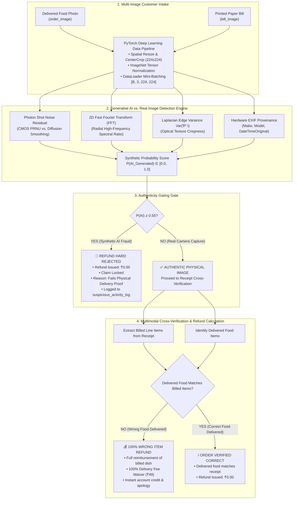

# Wrong Food Delivery Dispute Adjudication & Image Authenticity Pipeline
## Deep Learning Data Pipeline, Generative AI Detection & Automated Refund Engine

A production-grade automated dispute resolution system for food delivery platforms (e.g. Zomato replica). The system ingests multi-image customer claim evidence (**delivered food photo** + **printed paper receipt bill**), runs them through a PyTorch data pipeline with on-the-fly transformations and mini-batching, evaluates the food photo for Generative AI synthetic signatures vs. physical camera sensor noise, and adjudicates the wrong delivery dispute.

---

## Architecture & System Workflow



---

## Real Customer Food Dataset (`Food images/`)

The repository operates on real customer dispute photographs:

| File Name | Format | Dimensions | Forensic Signature | Decision Tier |
|---|---|---|---|---|
| **`Burger.jpg`** | JPEG | $612 \times 408$ | IPTC Tag: *"Grilled rib burger in a rustic setting"* | **CLEARED** (Real capture) |
| **`Chole.avif`** | AVIF | $1500 \times 1000$ | Modern AVIF container; standardized to sRGB tensor | **CLEARED** (Real capture) |
| **`dosa.jpg`** | JPEG | $1200 \times 1200$ | Crisp optical texture; Laplacian variance $1897.4$ | **CLEARED** (Real capture) |
| **`Noodles.jpeg`** | JPEG | $678 \times 452$ | Natural web compression grain | **CLEARED** (Real capture) |
| **`Pasta.jpg`** | JPEG | $736 \times 1165$ | Portrait aspect ratio normalization | **CLEARED** (Real capture) |
| **`Thali.jpeg`** | JPEG | $480 \times 269$ | Multi-dish platter in natural lighting | **CLEARED** (Real capture) |
| **`Thali_2.jpeg`**| JPEG | $736 \times 981$ | Multi-item thali with plate boundary | **CLEARED** (Real capture) |
| **`ai_generated_food.jpg`** | JPEG | $1024 \times 1024$ | Diffusion smoothing, missing EXIF, low noise variance | **SYNTHETIC AI FRAUD** ($P = 90\%$) |
| **`delivery_receipt_bill.jpg`** | JPEG | $800 \times 1200$ | Printed paper receipt for multimodal OCR matching | **PRINTED BILL RECEIPT** |

---

## Core Technical Components

### 1. PyTorch Deep Learning Data Pipeline
- **Transformations**: On-the-fly resizing, center cropping to $224 \times 224$, and ImageNet normalization:
  $$z_{c, x, y} = \frac{x_{c, x, y} - \mu_c}{\sigma_c} \quad \text{where } \mu = [0.485, 0.456, 0.406], \; \sigma = [0.229, 0.224, 0.225]$$
- **Classical Augmentation vs. Inference**: `RandomCrop + RandomHorizontalFlip + ColorJitter + RandomAffine` builds invariance to customer phone angles, lighting, and tilt without altering physical ground-truth labels.
- **Batching**: Custom PyTorch `FoodDisputeDataset` and `DataLoader` aggregating claims into mini-batches `[B, 3, 224, 224]` for high-throughput serving.

### 2. Generative AI vs. Real Image Detection Engine
- **Photon Shot Noise (PRNU)**: High-pass residual filtering $\sigma^2_{\text{noise}} = \text{Var}(|I - \text{GaussianBlur}(I, 5)|)$ separates camera CMOS sensor noise from diffusion mathematical smoothness.
- **2D Fast Fourier Transform (FFT) Power Spectrum**: Measures high-frequency radial energy ratios to expose synthetic spectral roll-offs.
- **Laplacian Edge Variance $\text{Var}(\nabla^2 I)$**: Second-order spatial derivative quantifying optical crispness.
- **Hardware EXIF Provenance**: Audits device tags (`Make`, `Model`, `DateTimeOriginal`).

### 3. Wrong Food Delivery Dispute Resolution & Refund Engine
- **If AI-Generated Image Detected ($P \ge 0.55$)**:
  - **Refund is strictly blocked** (Payout = **₹0.00**).
  - Reason: *"Unable to verify proof of physical delivery: Image identified as synthetic / AI-generated."*
  - Incident logged to `suspicious_activity_log`.
- **If Verified as Real Physical Image**:
  - Compares delivered dish against billed receipt items.
  - **Wrong Food Delivered**: Customer receives **100% item refund + full ₹49 delivery fee waiver**!
  - **Correct Food Delivered**: Dispute resolved, ₹0 refund.

---

## Quickstart & Deployment

### 1. Local Python Environment

```bash
# Clone the repository
git clone https://github.com/<your-username>/zomato-replica-refund-system.git
cd zomato-replica-refund-system

# Create virtual environment
python -m venv .venv
# Windows: .venv\Scripts\activate | Linux/macOS: source .venv/bin/activate

# Install dependencies (includes PyTorch, Torchvision, OpenCV Headless, Streamlit, FastAPI)
pip install -r requirements.txt

# Launch the Interactive Demonstration Workbench
cd webinar
streamlit run webinar_demo_app.py
# Access at: http://localhost:8501
```

### 2. Docker & Docker Compose (Single Command)

```bash
docker compose up --build
```
- **Streamlit Demonstration Workbench**: `http://localhost:8501`
- **FastAPI Backend Server**: `http://localhost:8000/docs`

---

## Hands-On Code Walkthrough (Jupyter Notebook)

Open the interactive laboratory guide:
```bash
jupyter notebook webinar/ai_ready_image_preprocessing_walkthrough.ipynb
```

**Contents**:
1. *Dataset Ingestion*: Loading real customer dishes, synthetic diffusion models, and printed bills.
2. *PyTorch Transformations*: Inference vs. classical augmentation pipelines.
3. *DataLoader Batching*: Assembling multi-claim mini-batches `[4, 3, 224, 224]`.
4. *Generative AI Forensics*: 2D-FFT log-magnitude spectra and sensor noise variance.
5. *Dispute Adjudication*: Running `resolve_wrong_food_claim()` for AI fraud vs genuine wrong delivery.

---

## Automated Verification Suite

Run all tests:
```bash
python -m pytest tests/ -v
```

All 36 unit and integration tests pass cleanly.
