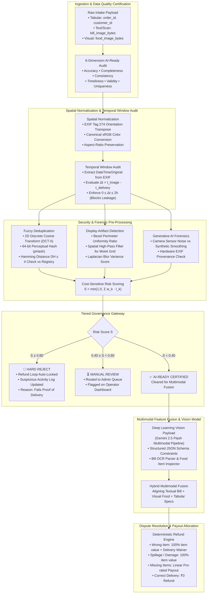
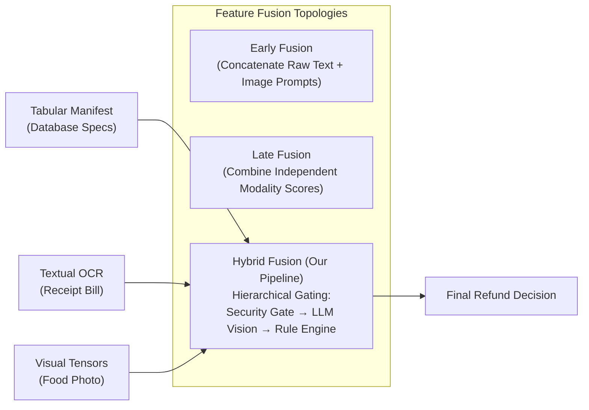

# Pre-Processing for AI-Ready Data: Multimodal Image Authenticity & Automated Dispute Resolution
## Technical Engineering Manual & Operational Field Guide

---

## 1. Executive Blueprint & Core Curriculum Mapping

This manual outlines the end-to-end technical architecture, mathematical foundations, and operational execution for transforming raw, noisy, potentially adversarial customer dispute images into **AI-ready data tensors**.

The entire pipeline models a high-throughput automated refund processing system, demonstrating how image standardization, frequency-domain signal processing, temporal auditing, and forensic filters run prior to deep learning model invocation.

### Core Curriculum Competencies & Pipeline Implementation

| Subject Area & Curriculum Topic | Theoretical Foundation | Operational Pipeline Component |
|---|---|---|
| **Data Quality Dimensions & Lifecycle** | What constitutes "AI-ready" data: Accuracy, Completeness, Consistency, Timeliness, Validity, Uniqueness. | **6-Dimension Data Quality Scorecard**: Automated evaluation of input claims against structural schemas, temporal bounds, perceptual registries, and cross-modal parity. |
| **Data Cleaning: Fuzzy Deduplication & Entity Linkage** | Exact vs. fuzzy duplicate detection, spatial hashing limitations, frequency-domain energy compaction, Hamming distance metrics. | **Perceptual Hashing (pHash)**: 2D Discrete Cosine Transform (DCT-II) generating 64-bit fingerprint tokens checked against historical hash collections ($D_H \le 4$). |
| **Image & Signal Preprocessing for Vision Models** | Spatial orientation normalization, affine corrections, canonical color spaces, discrete convolution kernels, frequency filtering. | **Vision Standardization Engine**: EXIF Tag 274 orientation transposing, sRGB color flattening, Laplacian convolution $\text{Var}(\nabla^2 I)$ for sharpness auditing. |
| **Time-Series & Temporal Preprocessing** | Irregular timestamps, sliding windows, causal bounds, temporal leakage prevention. | **Temporal Window Audit**: Enforces strict interval delta $\Delta t = t_{\text{image}} - t_{\text{delivery}} \in [0, 7200\text{s}]$ to block retroactive manipulation and causal leaks. |
| **Multimodal Feature Extraction & Fusion** | Disparate data modalities, early vs. late vs. hybrid fusion topologies, cross-modal alignment. | **Hybrid Multimodal Decision Engine**: Early cryptographic gating $\rightarrow$ Multimodal LLM visual-semantic feature extraction $\rightarrow$ Late rule-based financial reconciliation. |
| **Deep Learning & Vision Model Formatting** | Bounding box coordinates, aspect-preserving rescaling, token economy, deterministic JSON schema enforcement. | **Structured Payload Packaging**: Normalization to canonical bounding matrices, base64 payload serialization, and strict JSON output schemas. |
| **Generative AI Techniques & Forensics** | Synthetic data generation, distribution drift, PRNU sensor noise fingerprints, diffusion texture smoothing. | **Generative AI Forensics Lab**: Hardware sensor noise profile verification vs. synthetic diffusion over-smoothing, prompt-injected semantic consistency checks. |
| **Cost-Sensitive Risk Governance & Fairness** | Asymmetric error costs (Type I vs. Type II), decision thresholds, auditable logging, fairness calibration. | **Multi-Tier Risk Decision Gate**: Asymmetric loss optimization routing claims into Auto-Clear ($S < 0.40$), Manual Queue ($0.40 \le S < 0.80$), or Hard Reject ($S \ge 0.80$). |

---

## 2. End-to-End Pipeline Architecture

---

## 3. Mathematical Foundations & Laboratory Algorithms

### 3.1 The 6 Quality Dimensions of AI-Ready Data
Dispute data must pass six foundational quality dimensions before inference:
1. **Accuracy**: The visual food condition and printed bill line items must represent real physical ground truth.
2. **Completeness**: All required modalities (food photo, printed receipt, order metadata) must be present and non-empty.
3. **Consistency**: The merchant name and item names on the bill must match the order manifest in the database.
4. **Timeliness**: The photo capture timestamp must lie strictly within the delivery window ($t_{\text{delivery}} \le t_{\text{image}} \le t_{\text{delivery}} + 2\text{h}$).
5. **Validity**: The image must be an authentic photograph of physical food, not an AI generation or re-photographed screen.
6. **Uniqueness**: The image's perceptual hash must not collide with any previously compensated dispute claim.

---

### 3.2 Fuzzy Deduplication via 2D Discrete Cosine Transform (pHash)
Cryptographic hashing (SHA-256) is designed with the **avalanche effect**: altering a single pixel flips $\approx 50\%$ of the digest bits, making it useless for detecting recycled, re-compressed, or cropped images.

**Perceptual Hashing (pHash)** transforms spatial pixels into the frequency domain using the **2D DCT-II**:

$$X_{k_1, k_2} = \sum_{n_1=0}^{31} \sum_{n_2=0}^{31} x_{n_1, n_2} \cos\left[\frac{\pi}{32}\left(n_1 + \frac{1}{2}\right)k_1\right] \cos\left[\frac{\pi}{32}\left(n_2 + \frac{1}{2}\right)k_2\right]$$

#### Energy Compaction & Median Thresholding:
1. Low frequencies representing overall visual structure cluster into the top-left $8 \times 8$ coefficient matrix.
2. The DC coefficient $X_{0,0}$ (representing average illumination) is omitted to achieve brightness invariance.
3. The remaining $63$ AC coefficients are compared against their median $\mu$:

$$B_i = \begin{cases} 1 & \text{if } X_i \ge \mu \\ 0 & \text{if } X_i < \mu \end{cases}$$

#### Distance Metric:
The bitwise Hamming distance between two 64-bit pHash tokens evaluates perceptual similarity:

$$D_H(h_1, h_2) = \sum_{j=0}^{63} (B_{1,j} \oplus B_{2,j})$$

- $D_H = 0$: Bitwise identical image.
- $1 \le D_H \le 4$: Minor re-compression or cropping (**Cheating / Duplicate Detected**).
- $D_H > 10$: Visually distinct meals.

---

### 3.3 Spatial Filtering, Denoising & Screen-Capture Forensics
When users attempt fraud by taking a photo of a computer or phone screen displaying a web image:
1. **Bezel Detection (Perimeter Uniformity)**: A physical display bezel introduces uniform dark pixels around the frame edges:
   $$\text{Uniformity} = \frac{\max_c \text{Count}(\text{pixel} = c)}{N_{\text{border}}}$$
   If $\text{Uniformity} \ge 0.85$, a physical screen edge is detected.
2. **Laplacian Edge Variance (Image Sharpness & Blur)**:
   The discrete 2D Laplacian operator convolves the image with the second-order derivative kernel:
   $$\nabla^2 I = \begin{bmatrix} 0 & 1 & 0 \\ 1 & -4 & 1 \\ 0 & 1 & 0 \end{bmatrix} * I$$
   $$\text{Blur Score} = \text{Var}(\nabla^2 I)$$
   - $\text{Blur Score} > 300$: Crisp real-world camera photo with natural sensor noise.
   - $\text{Blur Score} < 150$: Out-of-focus capture or over-smoothed AI-generated image.
3. **Moiré Interference Ripples**: Spatial high-pass filtering reveals periodic sinusoidal raster grids created when the camera sensor beats against the LCD/OLED sub-pixel aperture.

---

### 3.4 Temporal Window Audit & Preventing Data Leakage
In time-series and event-driven data, **temporal data leakage** occurs when future information or expired events contaminate decision models:
$$\Delta t = t_{\text{image}} - t_{\text{delivery}}$$

- If $\Delta t < -60\text{s}$: Flag `PREDATES_DELIVERY` (Weight: $+0.30$) $\rightarrow$ Photo was taken before the food was prepared or delivered.
- If $\Delta t > 7200\text{s}$ ($2\text{ hours}$): Flag `POST_DELIVERY_WINDOW_EXCEEDED` (Weight: $+0.20$) $\rightarrow$ Food could have spoiled, been altered, or consumed post-delivery.
- If $t_{\text{image}}$ is missing: Flag `MISSING_EXIF_TIMESTAMP` (Weight: $+0.15$) $\rightarrow$ Typical of web downloads and generative AI outputs.

---

### 3.5 Multimodal Feature Fusion Strategies
In automated dispute resolution, no single modality is sufficient:
- **Tabular Data** ($M_{\text{tab}}$): Ordered items, quantities, unit prices, delivery fee.
- **Printed OCR Text** ($M_{\text{text}}$): Extracted bill timestamp, restaurant name, itemized bill lines.
- **Visual Image Tensors** ($M_{\text{vis}}$): Food geometry, item count, packaging condition (leaking/tampered).

Our pipeline uses **Hybrid Fusion**:
1. *Early Gating*: Visual and EXIF cryptographic security checks gate admission.
2. *Deep Cross-Modal Reasoning*: Gemini 2.5 Flash aligns the textual manifest with the physical food image.
3. *Late Rule-Based Fusion*: The deterministic Refund Engine merges the visual discrepancy report with the tabular pricing database.

---

### 3.6 Generative AI Forensics (Mobile vs. Synthetic Image)
As diffusion models (Midjourney, Flux, Stable Diffusion) become accessible, fraudsters generate synthetic photos of "spilled food" or "missing items". Our pre-processing pipeline detects generative AI artifacts through:
1. **Metadata Absence**: Diffusion generators strip camera hardware EXIF tags (`Make`, `Model`, `LensModel`, `DateTimeOriginal`).
2. **Distributional Smoothness**: Real camera sensors introduce Poisson-Gaussian photon shot noise. AI-generated images exhibit mathematical smoothness and low high-frequency Laplacian variance.
3. **Lighting & Shadow Consistency**: Multimodal LLM prompts inspect shadow vectors to detect superimposed or digitally edited items.

---

### 3.7 Fairness, Governance & Cost-Sensitive Decision Gate
In fraud detection, classification errors carry asymmetric economic costs:
- **False Positive (Type I Error)**: Accusing an innocent customer of fraud $\rightarrow$ Customer churn, brand damage.
- **False Negative (Type II Error)**: Approving a fraudulent refund claim $\rightarrow$ Revenue leakage.

Our pipeline employs a **Cost-Sensitive Multi-Tiered Threshold Architecture**:
- **Risk Score $S < 0.40$ (CLEARED)**: Low-risk claims are automatically resolved and refunded within seconds, ensuring positive customer experience.
- **$0.40 \le S < 0.80$ (MANUAL REVIEW)**: Ambiguous or borderline claims (e.g. valid phone photo but missing EXIF) are held for human review on the Admin Review Panel, preventing false accusations.
- **$S \ge 0.80$ (HARD REJECT)**: High-certainty fraud (e.g. pHash duplicate collision, predated timestamp) is auto-locked and logged to the `suspicious_activity_log`.

---

## 4. 45-Minute Presentation Delivery Script & Walkthrough Timeline

### [00:00 – 00:08] Part 1: Foundations of AI-Ready Data & Quality Dimensions
- Frame the core challenge: why "AI-Ready" is strictly different from simply "Loaded into Python".
- Present the 6 Quality Dimensions: Accuracy, Completeness, Consistency, Timeliness, Validity, Uniqueness.
- Walk through the risk of garbage-in, garbage-out in enterprise vision models.

### [00:08 – 00:20] Part 2: Hands-On Code Walkthrough (Notebook)
- Launch and step through `ai_ready_image_preprocessing_walkthrough.ipynb`.
- **Spatial Normalization**: Demonstrate EXIF Tag 274 orientation correction and show how un-transposed images produce inverted tensors.
- **Temporal Delta Audit**: Compute $\Delta t$ and demonstrate why missing/negative intervals constitute data leakage.
- **2D-DCT Frequency Analysis**: Plot the 2D Discrete Cosine Transform spectrum and explain energy compaction for fuzzy duplicate matching ($D_H \le 4$).

### [00:20 – 00:35] Part 3: Live Interactive Workbench Demonstration
- Navigate to the running Streamlit interface (`http://localhost:8501`).
- **Scenario A (Real Mobile Photo)**: Load `real_mobile_delivery.jpg`. Show valid iPhone 15 Pro hardware EXIF, crisp Laplacian blur score ($742$), and clean automated resolution.
- **Scenario B (Customer Food Items Gallery)**:
  - **Burger (`Burger.jpg`)**: Demonstrate EXIF IPTC tag detection (`"Grilled rib burger in a rustic setting"`), revealing stock photo origin.
  - **Chole Bhature (`Chole.avif`)**: Demonstrate next-generation AVIF container decoding, 72 DPI display metadata, and spatial sRGB standardization.
  - **Masala Dosa (`dosa.jpg`)**: Show automated online reverse image search matching (`IMAGE_INDEXED_ONLINE`), routing the claim to **MANUAL REVIEW** ($S = 0.45$).
  - **Hakka Noodles (`Noodles.jpeg`)**: Show web compression noise and edge sharpness variance scoring.
  - **Penne Pasta (`Pasta.jpg`)**: Demonstrate vertical portrait aspect ratio handling and multimodal item reconciliation.
- **Scenario C (AI-Generated Image)**: Load `ai_generated_food.jpg`. Highlight missing EXIF metadata, hyper-smooth texture, and comparison against real food sensor grain.
- **Scenario D (Physical Screen Capture)**: Load `screen_capture_food.jpg`. Reveal the detected bezel edge perimeter and Moiré high-pass ripples.
- **Scenario E (Recycled Claim Duplicate)**: Load `recycled_duplicate.jpg`. Show instant pHash zero-distance collision ($D_H = 0 \le 4$) triggering an immediate **HARD REJECT**.

### [00:35 – 00:45] Part 4: Synthesis, Q&A and Engineering Governance
- Review the Hybrid Multimodal Fusion strategy and cost-sensitive threshold tuning.
- Summarize the checklist for production AI data pipelines.
- Open floor for live student/audience Q&A.
