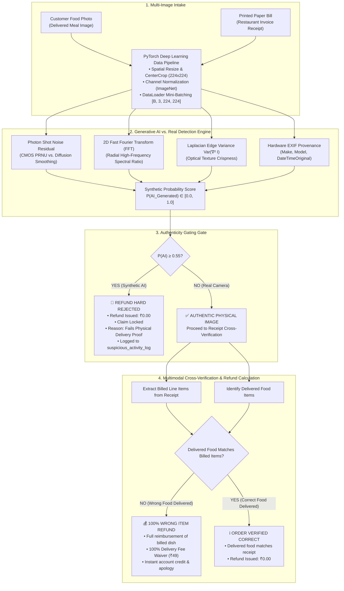

# Wrong Food Delivery Dispute Adjudication & Image Authenticity Pipeline
## Technical Engineering Manual & Webinar Delivery Playbook

---

## 1. Executive Summary & Curriculum Blueprint

This technical manual details the engineering architecture for an automated dispute resolution system tailored to food delivery platforms (e.g. Zomato replica).

### Operational Use Case:
- Customers frequently request refunds claiming: *"I received the wrong food order!"*
- The customer is required to provide two physical pieces of evidence:
  1. **Delivered Food Photo**: Proof of the dish physically received.
  2. **Printed Bill Receipt**: The restaurant paper bill attached to the delivery bag.
- **The Core Threat**: Malicious users submit **Generative AI synthetic images** (diffusion outputs of incorrect dishes) to game the automated refund system.
- **The Core Objective**:
  - Ingest both images through a **Deep Learning Data Pipeline** (PyTorch transformations, on-the-fly augmentation, and mini-batching).
  - Execute a **Generative AI vs. Real Image Detection Engine** to verify the authenticity of the food photograph.
  - **If the image is AI-Generated**: Instantly **lock the refund loop**, issue **₹0.00**, and log the incident to the security log.
  - **If the image is Real**: Cross-verify the delivered dish against the printed receipt items. If wrong food is confirmed, issue **100% item refund + full delivery fee waiver**!

---

## 2. End-to-End System Architecture

---

## 3. Mathematical Foundations & Implementation Details

### 3.1 PyTorch Deep Learning Data Pipeline
Deep vision models require standardized 3-channel tensors:
$$z_{c, x, y} = \frac{x_{c, x, y} - \mu_c}{\sigma_c} \quad \text{where } c \in \{R, G, B\}$$

- **Inference Pipeline**: Deterministic `Resize(224) -> CenterCrop(224) -> ToTensor() -> Normalize(mean, std)`.
- **Classical Augmentation Pipeline**: `RandomCrop(224) -> RandomHorizontalFlip(p=0.5) -> ColorJitter() -> RandomAffine()`.
  Unlike Generative AI (which alters semantic content and risks hallucinations), classical augmentation preserves ground-truth labels while training models to be invariant to customer camera tilt and ambient lighting.
- **Batched Serving**: Aggregates claims into mini-batches `[B, 3, 224, 224]` via PyTorch `DataLoader`.

---

### 3.2 Generative AI vs. Real Image Forensics
1. **CMOS Sensor Photon Shot Noise (PRNU)**:
   Real camera sensors introduce Poisson-Gaussian photon shot noise. High-pass residual filtering:
   $$R = |I - \text{GaussianBlur}(I, 5)| \quad \implies \quad \sigma^2_{\text{noise}} = \text{Var}(R)$$
   - Real Camera: $\sigma^2_{\text{noise}} > 20.0$.
   - Diffusion AI: $\sigma^2_{\text{noise}} < 8.0$ (hyper-smooth surfaces).
2. **2D Fast Fourier Transform (FFT) Power Spectrum**:
   $$F(u, v) = \sum_{x=0}^{M-1} \sum_{y=0}^{N-1} f(x, y) \exp\left[-j 2\pi \left(\frac{ux}{M} + \frac{vy}{N}\right)\right]$$
   Real optical lenses sustain high-frequency power across outer radial bands ($r > \frac{\min(H, W)}{8}$). Synthetic diffusion generators exhibit steep radial power drops or grid artifacts.
3. **Laplacian Edge Variance**:
   $$\text{Blur Score} = \text{Var}(\nabla^2 I) = \text{Var}\left(\begin{bmatrix} 0 & 1 & 0 \\ 1 & -4 & 1 \\ 0 & 1 & 0 \end{bmatrix} * I\right)$$
4. **Hardware Provenance Audit**:
   Checks for stripped device tags (`Make`, `Model`, `DateTimeOriginal`).

---

### 3.3 Dispute Adjudication & Payout Rules
- **Rule 1 (AI Gate)**: If $P(\text{AI}) \ge 0.55 \implies \text{Payout} = \text{₹}0.00$.
- **Rule 2 (Wrong Item Gate)**: If Real Camera and Observed Dish $\ne$ Billed Dish:
  $$\text{Total Payout} = \sum_{i \in \text{Billed}} (\text{Price}_i \times \text{Qty}_i) + \text{Waiver}_{\text{delivery}} (\text{₹}49.00)$$
- **Rule 3 (Matching Delivery Gate)**: If Real Camera and Observed Dish = Billed Dish $\implies \text{Payout} = \text{₹}0.00$.

---

## 4. 45-Minute Presentation Delivery Script & Walkthrough Timeline

### [00:00 – 00:10] Part 1: Problem Framing & The Wrong Food Dispute Challenge
- Introduce the operational challenge: high-volume customer complaints alleging wrong food delivery.
- Explain the multi-image requirement: Customer must submit both **Delivered Food** and **Printed Paper Bill**.
- Highlight the modern fraud vector: Customers submitting photorealistic Generative AI food photos to claim wrong delivery.

### [00:10 – 00:22] Part 2: Hands-On Code Walkthrough (Notebook)
- Launch `ai_ready_image_preprocessing_walkthrough.ipynb`.
- **PyTorch Pipeline**: Walk through `transforms.Compose`, ImageNet normalization, classical data augmentation vs. inference, and DataLoader mini-batch assembling (`[4, 3, 224, 224]`).
- **Forensic Extraction**: Run the 2D-FFT magnitude spectrum and sensor noise residual. Compare the real Masala Dosa spectrum against the synthetic diffusion image.
- **Refund Logic**: Run `resolve_wrong_food_claim()` showing how AI fraud is rejected with ₹0 payout, while genuine wrong delivery receives a 100% item refund + delivery fee waiver.

### [00:22 – 00:38] Part 3: Live Interactive Workbench Demonstration
- Open `http://localhost:8501`.
- **Demo Scenario 1 (AI Fraud Attempt)**:
  - Select `Synthetic: AI-Generated Food` as the food photo + `delivery_receipt_bill.jpg`.
  - Show Tab 2: $P(\text{AI}) = 90.0\%$, low sensor noise, steep spectral roll-off.
  - Show Tab 3: System **Hard Rejects** the claim (Payout = **₹0.00**), locks the refund loop.
- **Demo Scenario 2 (Genuine Customer Wrong Food Delivery)**:
  - Select `Real Food: Masala Dosa` as the food photo + `delivery_receipt_bill.jpg` (billed for Butter Chicken).
  - Show Tab 2: Authentic camera capture confirmed ($P(\text{AI}) = 2.0\%$).
  - Show Tab 3: Discrepancy confirmed (received Masala Dosa instead of Butter Chicken).
  - System automatically approves **₹689.00** refund (100% item value of ₹640 + ₹49 delivery waiver)!
- **Demo Scenario 3 (Real Food: Ingesting Diverse Formats & Aspect Ratios)**:
  - Test `Chole.avif` (modern AVIF container) and `Pasta.jpg` (portrait orientation). Show consistent tensor transformations in Tab 1.

### [00:38 – 00:45] Part 4: Synthesis, Q&A and Engineering Governance
- Summarize the checklist for deploying multi-image dispute systems.
- Explain cost-sensitive threshold calibration: preventing false rejections of genuine customers while isolating synthetic fraud.
- Open floor for audience Q&A.
